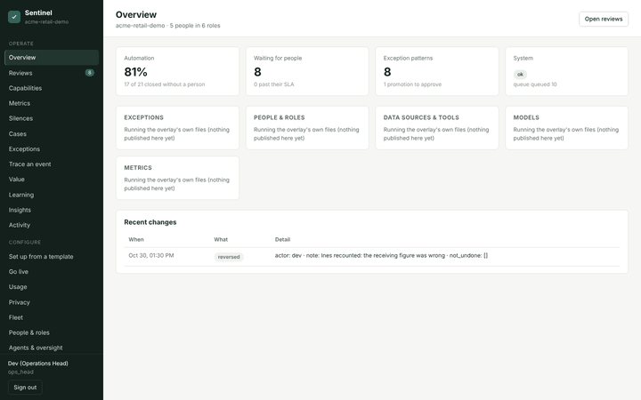
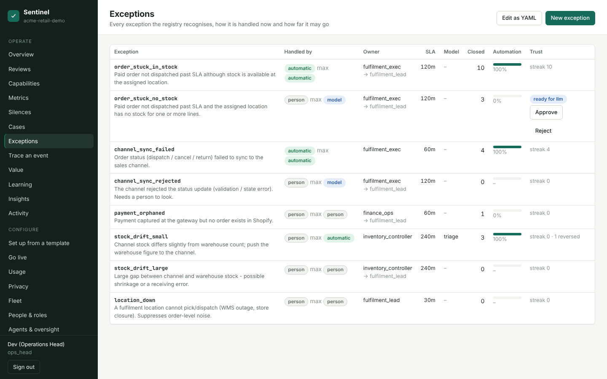
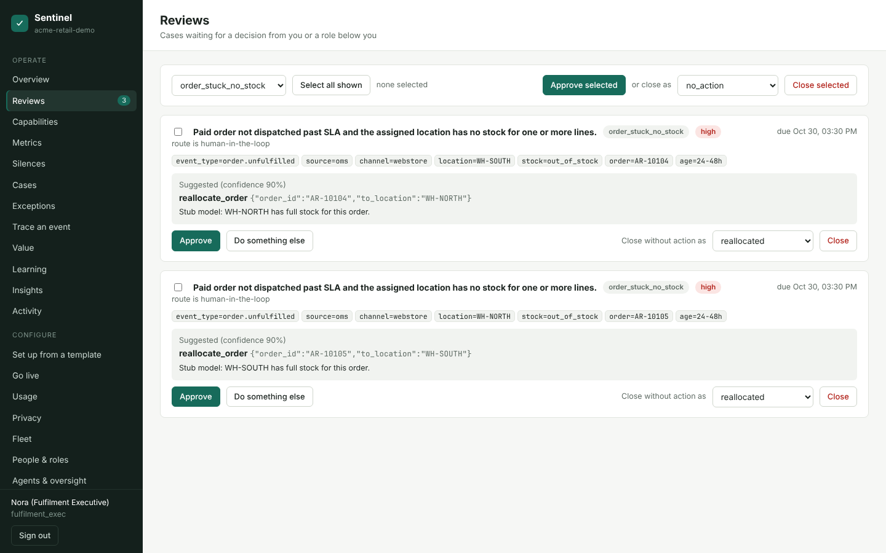
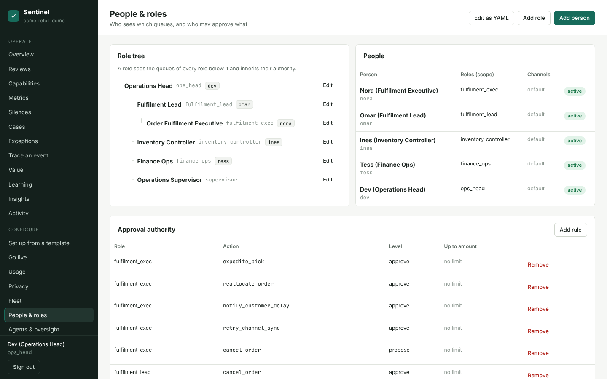

# The five-minute demo

A made-up retailer, **Acme Retail**, with invented orders, stock and payments, so you can see what Sentinel does
without connecting anything. No Docker, no Postgres, no API key and no network: the "model" is a labelled stub
that answers from a fixed table.



## Run it

```bash
git clone https://github.com/MohanKbgrid/kbg-platform.git
cd kbg-platform/sentinel
pip install -e ".[dev]"
python -m sentinel.demo
```

Python 3.11 or newer. The terminal prints the address and five sign-in tokens. Open
<http://localhost:8080/console>, paste a token, and sign in. Stop with Ctrl-C (the temporary data is removed).

| Token | Who | Why sign in as them |
|---|---|---|
| `demo-dev-ops-head` | Dev, operations head | Approve the pending step up; reverse a decision; see everything |
| `demo-nora-fulfilment-exec` | Nora, fulfilment executive | Work the order queue |
| `demo-omar-fulfilment-lead` | Omar, fulfilment lead | Sees the queues below him; takes escalations |
| `demo-ines-inventory` | Ines, inventory controller | Stock gaps |
| `demo-tess-finance-ops` | Tess, finance ops | Payments with no order (refunds are capped at 10,000) |

Options: `--port 8081`, `--host 0.0.0.0` (the tokens are public, so do not expose this), `--db demo.db` to keep the
data between runs, `--check` to build and seed and print a summary without serving.

## What to look at

The demo loads 31 events. Every run gives the same result.

1. **Handled (21 cases, 17 of them without a person).** Overview shows the share. Ten paid orders stuck past
   their SLA with stock on the shelf were expedited; four timed-out channel updates were retried (one failed once,
   then landed: Cases, open it, read the audit trail); three small stock gaps were corrected by the stub model
   (one of those is reversed, see 4). The other four were approved by Nora (three order moves) and Tess (a payment).
2. **Waiting for a person (8).** Reviews, signed in as Nora, Omar, Ines, Tess or Dev. Each card says why a person
   is needed and carries a proposal. A store outage (`STORE-12`) suppressed two order alerts instead of paging
   anyone about each one.
3. **A step up for you to approve.** Exceptions, signed in as Dev: `order_stuck_no_stock` shows
   *ready for llm*. Three approved proposals in a row earned it a move from a person to the model. Press
   **Approve**. Nobody but the operations head can.
4. **A reversal that stepped back.** Cases: the stock correction for `SKU-2003` was reversed (the channel figure
   was restored) and `stock_drift_small` went back to needing a person. The next stock gap, `SKU-2004`, waits for
   Ines for that reason. Exceptions shows "1 reversed".







## In Docker instead

```bash
cd sentinel/deploy/demo
docker compose up --build
```

Same demo on <http://localhost:8080/console>. The compose file has not been run by its author yet; see
[deploy/demo/README.md](../deploy/demo/README.md).

## Where the pieces are

- `sentinel/demo.py`: the whole demo (overlay, invented actions, stub model, seed, server). Start there to see how
  an overlay is put together; it is built from `templates/retail-fulfilment.yaml` and the
  [overlay contract](OVERLAY_CONTRACT.md).
- `scripts/gen_screenshots.py`: regenerates the pictures on this page (`python scripts/gen_screenshots.py`).
- Next: [ARCHITECTURE](ARCHITECTURE.md), [OPERATIONS](OPERATIONS.md), [EXTENDING](EXTENDING.md).
